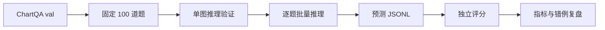

# Qwen3-VL 图表问答与评测

在 RTX 4060 Laptop GPU 8GB 上运行 Qwen3-VL-2B，构建 ChartQA 固定样本推理、自动评分和错误分析流程。项目后续将开展 LoRA SFT 与可验证合成数据实验，比较基座、原始数据微调和数据增强微调的效果。

当前完成 **P0 Baseline**。已有真实预测、固定评测清单、独立评分脚本和人工复盘记录。LoRA 训练和合成数据实验处于规划阶段。

## 实测结果

模型使用 `Qwen/Qwen3-VL-2B-Instruct`，在 ChartQA 官方 `val` 的 1,920 道题中，用种子 `42` 从 `human` 和 `augmented` 各抽 50 道。下表统计固定的 100 道开发题，评测范围为这一验证子集。

| 题目来源 | 题数 | Exact Match | P0 Relaxed Accuracy |
| --- | ---: | ---: | ---: |
| `human` | 50 | 62%（31/50） | 74%（37/50） |
| `augmented` | 50 | 76%（38/50） | 86%（43/50） |
| **总体** | **100** | **69%（69/100）** | **80%（80/100）** |

100 道均生成预测，缺失为 0。对保存的预测执行两次评分，整体及分组统计一致。批量推理的 PyTorch 峰值分配显存为 **4,220.5 MiB（约 4.12 GiB）**，峰值预留为 4,318.0 MiB。该数值包含加载与推理阶段，测量范围为 PyTorch CUDA 分配器。

核对证据可直接打开[统计汇总](outputs/chartqa_p0/batch_bf16_512/summary.json)、[原始预测](outputs/chartqa_p0/batch_bf16_512/predictions.jsonl)、[逐题评分](outputs/chartqa_p0/batch_bf16_512/scored_predictions.jsonl)和[运行配置](outputs/chartqa_p0/batch_bf16_512/config.json)。

## 运行流程



| 脚本 | 作用 |
| --- | --- |
| [inspect_chartqa.py](scripts/inspect_chartqa.py) | 下载验证 Parquet，固定抽样清单，导出首题图片及问答 |
| [run_baseline.py](scripts/run_baseline.py) | 用首题验证模型加载、图像处理、文本生成与显存 |
| [run_baseline_batch.py](scripts/run_baseline_batch.py) | 读取清单和单图配置，加载一次模型，逐题保存预测并支持续跑 |
| [evaluate.py](scripts/evaluate.py) | 校验样本 ID、元数据和清单哈希，计算指标并导出错例 |

推理时输入图片和问题，参考答案用于生成完成后的评分。批量阶段每次处理 1 道题，模型始终驻留同一块 GPU。

## 快速复算已保存的结果

仓库保留了小型文本实验记录。使用 Python 3.12，在项目根目录运行以下命令即可复算分数。评分脚本仅使用 Python 标准库，CPU 即可完成。

```powershell
python scripts/evaluate.py
```

预期输出的关键数字为 `exact_correct = 69`、`relaxed_correct = 80`、`missing_predictions = 0` 和 `Bad cases: 20`。脚本会重新写入派生的逐题评分、汇总及错例文件。

`manifest.json` 的原始字节参与哈希校验，`.gitattributes` 为实验记录保留原始字节。编辑器格式化或重新保存清单后，需要重新核对清单与运行配置的一致性。

## 本地 GPU 推理

### 已验证环境

| 组件 | 版本或配置 |
| --- | --- |
| 系统 | Windows 11，PowerShell |
| GPU | NVIDIA GeForce RTX 4060 Laptop GPU，8GB |
| 驱动 | 591.74 |
| Python | 3.12.3 |
| PyTorch / torchvision | `2.10.0+cu130` / `0.25.0+cu130` |
| PyTorch CUDA runtime | `13.0` |
| Transformers / Accelerate | `4.57.6` / `1.12.0` |
| PyArrow / Pillow | `22.0.0` / `11.3.0` |

### 准备环境

以下命令适用于已经具有表中 GPU 版 PyTorch 的 Python。先检查现有环境，再创建可复用这些包的项目虚拟环境。

```powershell
python -c "import torch, torchvision; print(torch.__version__, torchvision.__version__, torch.version.cuda); print(torch.cuda.is_available())"
python -m venv --system-site-packages .venv
$P0Python = '.\.venv\Scripts\python.exe'
& $P0Python -m pip install --dry-run -r requirements.txt
```

审查预演清单，再安装项目依赖。`constraints-gpu.txt` 将 GPU 包固定为本次实测版本。已有这两个版本时 pip 会复用它们。新机器先依据自身系统和 GPU 配置安装兼容的 PyTorch，再准备项目环境；其他版本尚待验证。 [PyTorch 安装指南](https://pytorch.org/get-started/locally/)

```powershell
& $P0Python -m pip install -r requirements.txt
& $P0Python -c "from transformers import AutoProcessor, Qwen3VLForConditionalGeneration; import torch; print(torch.__version__, torch.version.cuda); print(torch.cuda.get_device_name(0), torch.cuda.is_bf16_supported())"
```

VS Code 中使用 `Python: Select Interpreter` 选择 `.venv\Scripts\python.exe`。下面的命令显式指定了该解释器。

### 下载验证数据和运行单图推理

首次运行需要从 Hugging Face 获取约 50 MB 的验证 Parquet，以及约 4.26 GB 的权重和配套处理器文件。缓存放在项目的 `.cache/huggingface/hub`。已有完整缓存时下载器会复用；数据和单图入口仍会联网查询固定版本的元数据。

```powershell
$env:HF_HOME = Join-Path $PWD.Path '.cache\huggingface'
& '.\.venv\Scripts\python.exe' '.\scripts\inspect_chartqa.py'
& '.\.venv\Scripts\python.exe' '.\scripts\run_baseline.py'
```

首题是 `val:6`，题目为 “What is the unfavourable value in 2014?”，参考和本次预测都是 `64`。该图输入含 120 个视觉 token，整条输入为 151 个 token。[单图记录](outputs/chartqa_p0/smoke_bf16_512.json)

### 批量推理和评分

```powershell
& '.\.venv\Scripts\python.exe' '.\scripts\run_baseline_batch.py'
& '.\.venv\Scripts\python.exe' '.\scripts\evaluate.py'
```

批量脚本按 `sample_id` 跳过已有预测，启动时校验清单和配置。下载仓库里的 100 条预测记录后再运行，脚本会报告已完成。如果要重新生成全部预测，先把已有的整个 `outputs/chartqa_p0/batch_bf16_512` 目录备份到项目外，再运行批量命令。单图、清单和缓存继续供它读取。

当前批量入口沿用 512-token 单图配置，使用离线缓存。单图的 `--max-image-tokens 256` 可用于显存排查；固定 100 题实验采用 512 设置，修改配置时需另开实验记录。

### 固定的模型与解码设置

| 设置 | 值 |
| --- | --- |
| 模型 commit | `89644892e4d85e24eaac8bacfd4f463576704203` |
| 数据 commit | `af8b6f5c08c95085271561c2a3f9d15f2b5a9031` |
| 精度 / 注意力实现 | BF16 / SDPA |
| 视觉 token 上限 / 新增 token 上限 | 512 / 32 |
| 解码 | 贪心，`do_sample=False` |
| 题目后追加的提示词 | `Answer with only the final answer.` |

## 评分规则与错误分析

**Exact Match** 统一大小写及空白后比较答案文本。**P0 Relaxed Accuracy** 对能解析的数值使用以下规则，其他答案按规范化文本匹配。

```text
|prediction - reference| <= 0.05 * |reference|
```

数值可包含正负号、小数和规范的千分位分隔符。参考为零时要求预测数值为零，百分号口径必须一致。列表、同义词和解释性回答目前使用文本匹配规则。评分脚本内置了零值、负数、容差边界、百分号和空输出等规则检查。5% 数值容差参考 ChartQA 论文，项目的文本规范化与解析规则可在评分源码中检查。 [ChartQA 论文](https://aclanthology.org/2022.findings-acl.177.pdf)

对 20 条自动判错中的 3 条做了原图复盘：

| 样本 | 参考 / 预测 | 原图核查 |
| --- | --- | --- |
| `val:159` | `0.354` / `35.4` | 图上标注英国为 `35.4%`，预测遗漏百分号，严格口径下判错 |
| `val:348` | `[Oppose, Favor]` / `Favor and Oppose` | 图例确为这两类，题目未指定顺序，人工判断语义等价，当前匹配规则未覆盖 |
| `val:281` | `No` / `Yes` | 深蓝最大值 47，浅蓝中位数 28，两者之和 75，确认答错 |

人工复盘保留了原始评分。后续若调整匹配规则，将用同一新版规则重评所有对照组。完整错例见 [bad_cases.csv](outputs/chartqa_p0/batch_bf16_512/bad_cases.csv)。

## 结果范围与后续实验

目前的 100 道题用于开发与链路验证，抽样误差和匹配规则都会影响得分。验证集会用于后续开发，官方 `train` 用于微调，`test` 预留给最终统一评估。当前实验记录能够复算评分；跨设备重新推理的数值确定性有待验证。

| 阶段 | 状态 | 目标 |
| --- | --- | --- |
| P0 基座 Baseline | 已完成 | 单图、固定清单推理、评分、日志和错例复盘 |
| P1 LoRA SFT | 待开展 | 检查训练样本和 loss mask，跑通训练冒烟与 adapter 保存加载，做 A/B 对照 |
| P2 可验证合成数据 | 待开展 | 程序绘图与答案计算，筛选并开展数据增强对照 |

## 数据与模型来源

仓库中的固定清单和预测记录含有 ChartQA 的题目及参考答案。下载数据、使用和分发时应遵循数据来源的说明。数据卡标注 `gpl-3.0`，模型卡标注 `apache-2.0`，原始图表的来源标识可在数据图像中查看。 [ChartQA 数据卡](https://huggingface.co/datasets/ahmed-masry/ChartQA) · [Qwen3-VL-2B-Instruct 模型卡](https://huggingface.co/Qwen/Qwen3-VL-2B-Instruct)

参考项目为 [Qwen3-VL 官方仓库](https://github.com/QwenLM/Qwen3-VL) 与 [ChartQA 官方仓库](https://github.com/vis-nlp/ChartQA)。
